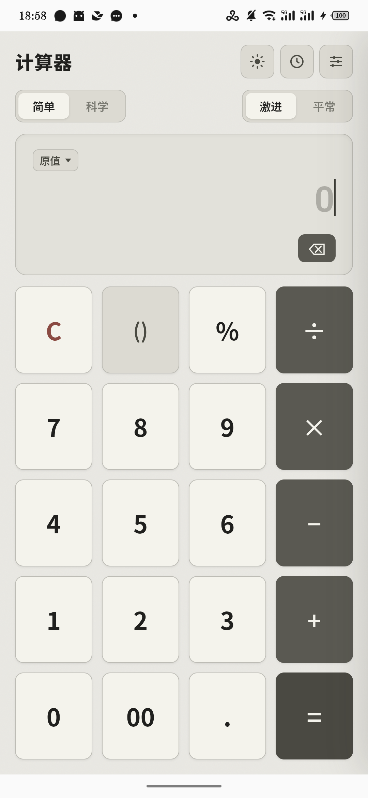

<div align="center">

# Ink Calculator · 墨水屏计算器

**别人不做的，我做。**

[](https://benyichan.github.io/ink-calculator/)
[](LICENSE)
[](https://github.com/benyichan/ink-calculator/releases)

[**🌐 产品介绍落地页**](https://benyichan.github.io/ink-calculator/) · [**📱 下载 APK v1.9.3**](apk/ink-calculator-v1.9.3.apk) · [**🏷 Releases**](https://github.com/benyichan/ink-calculator/releases) · [**▶️ 浏览器在线体验**](https://benyichan.github.io/ink-calculator/app/index.html)



</div>

---

> **缘起**：系统自带的计算器不能在输入框定位光标；好不容易找到符合要求的，打开有广告，想买会员国内又买不了。索性自己做一个——把想要的功能都加上，UI 也按自己喜欢的来。于是有了这个墨水屏计算器。

完整的产品故事、设计理念、功能演示和「为谁而做」，都在 **[产品介绍落地页](https://benyichan.github.io/ink-calculator/)** —— README 这里只讲怎么拿去用、怎么构建。

---

## 特性

- **墨水屏视觉**：纸色底、深灰细描边、CASIO 式细边框按键、纸感噪点纹理，深浅双主题
- **光标级编辑**：表达式任意位置插入/删除数字与运算符，点击定位光标，实时千分位显示
- **智能括号**：单个 `()` 键自动判断插入左括号 / 右括号，连续输入按同向处理（复合公式），运算完成自动跳出
- **计算历史**：手动（按 `=` 才记录）/ 自动（停顿可配置，默认 10 秒自动记录）双模式，默认保留 30 条，多选删除 + 一键清空
- **显示单位**：原值 / 千 / 万 / 十万 / 百万 / 千万 / 亿 / 十亿 / 百分比(%) / 人民币大写金额，结果态整体换算，历史记录实时重算
- **科学模式**：三角函数、对数、幂、开方、阶乘、DEG/RAD、记忆功能
- **贴心细节**：超长公式自动缩字号完整显示、零过多自动科学计数法、CASIO 式上下文百分号（`100-12.5% = 87.5`）、长按复制「算式 = 结果」整串到剪贴板
- **千分位速读**：顶部 `?` 内置单位顺序、三段对应表、读数示例和 Excel 随机练习公式，练习时随手可查

## 下载与体验

| 方式 | 入口 | 说明 |
|---|---|---|
| 📱 Android APK | [apk/ink-calculator-v1.9.3.apk](apk/ink-calculator-v1.9.3.apk) · [Releases](https://github.com/benyichan/ink-calculator/releases) | 自签名 release，Android 7.0 / API 24+，首次安装需允许「未知来源」 |
| ▶️ 浏览器版 | [在线打开](https://benyichan.github.io/ink-calculator/app/index.html) 或本地 [app/index.html](app/index.html) | 单文件、零依赖、离线可用，与 APK 界面源码完全一致 |
| 🌐 产品介绍 | [落地页](https://benyichan.github.io/ink-calculator/) |缘起、设计理念、体验演示、为谁而做 |

## 构建

本机需 JDK 21（Android Studio 自带 JBR）、Android SDK、Node.js。

```bash
npm install
npx cap sync android
cd android
./gradlew assembleRelease
# 产物：android/app/build/outputs/apk/release/app-release.apk
```

要重新签名：在 `android/app/` 放自己的 keystore，改 `android/app/build.gradle` 的 `signingConfigs`。

## 项目结构

| 路径 | 说明 |
|---|---|
| `index.html` | **GitHub Pages 落地页**（产品介绍宣传页，站点根） |
| `app/index.html` | 计算器完整源码（单文件 HTML：样式 + 解析引擎 + 界面） |
| `apk/` | 已签名的 release APK |
| `assets/` | 图标、OG 分享图、真机截图（落地页与 README 共用） |
| `robots.txt` / `sitemap.xml` / `llms.txt` | SEO / GEO 基建，随落地页发布 |
| `.nojekyll` | 关闭 Jekyll，保证 Pages 原样发布静态文件 |

> 落地页与 README 共用 `assets/`：改了截图或图标，两边同时生效。

## 技术说明

- 表达式解析为手写递归下降解析器，支持隐式乘法（`2(3+4)`）、一元负号、后缀 `%` / `!`
- 自绘光标替代原生 `<input>`，规避 Android WebView 唤起软键盘的问题
- 千分位仅为显示层改写，内部始终保存原始串；光标位置通过双向位置映射保持准确
- 剪贴板使用 `@capacitor/clipboard` 原生插件，规避 WebView 中 `execCommand` 在长按定时器内失效的问题

### 数值策略与语义约定

- **数值内核**：JavaScript IEEE-754 双精度。不是精确十进制 / 有理数内核，不做「1÷3×3 严格等于 1」的精确承诺。
- **展示归一**：仅展示层按 12 位有效数字归一（`0.1+0.2 → 0.3`，`1.005×100 → 100.5`），中间值不用 `toFixed` 修正。
- **容差**：`1e-12` 只用于 `sqrt / log / asin / acos / tan` 的定义域边界判断；除零按 `b === 0` 精确判断，`1/0` 报「不能除以零」。
- **幂运算**：右结合；`-2^2 = -4`，`(-2)^2 = 4`，`2^-3 = 0.125`；`0^0 = 1`（与 `Math.pow` 一致），负指数按倒数处理。
- **百分号**：`A+B% = A + A×B/100`，`A*B% = A×(B/100)`；括号结果后接 `%` 视为普通值（`(20+10)% = 0.3`），不触发上下文百分号。
- **安全上限**：表达式 500 字符 / 200 token / 解析深度 80 / 阶乘 ≤ 170；超限返回错误码，不卡死、不栈溢出。
- **单位兼容**：v1.8 新增「十万」档；旧版本已保存的单位选择会自动迁移到新下标，历史记录中的带单位字符串按后缀还原。
- **错误态**：计算核心返回 `{ok, value, code, message}`，UI 不直接接异常；`NaN / Infinity` 一律显示「无效」，不写入历史。
- **已知限制**：`1/3` 显示为 12 位有效数字的近似值；超过 `2^53` 的大整数会精度下降；需要精确十进制的场景请用专用工具。

### 测试

```bash
node --test tests/calc-core.test.js
```

覆盖 206 条黄金用例、1000 条随机属性测试、500 条模糊输入测试，以及每个已修 BUG 的具名回归用例。依赖安全扫描：`npm audit --registry=https://registry.npmjs.org --omit=dev` → 0 个漏洞（Critical / High / Moderate / Low 均为 0）。

## 协议

[MIT](LICENSE) © 2026 Benyi Chan
